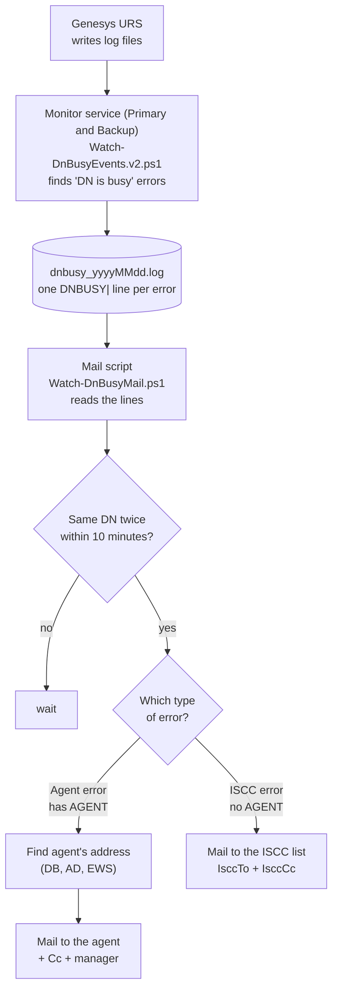

# DN is Busy – Simple Flow

(The detailed version is in [ARCHITECTURE.md](ARCHITECTURE.md); Hebrew: [ARCHITECTURE.he.md](ARCHITECTURE.he.md).)



Same flow as text:

```
URS logs
   |
   v
Monitor service (finds "DN is busy")
   |
   v
dnbusy_yyyyMMdd.log   (one DNBUSY| line per error)
   |
   v
Mail script  --- same DN twice within 10 minutes? ---
   |
   +--- Agent error (has AGENT) ---> find agent's address (DB / AD / EWS) ---> mail to AGENT (+ Cc + manager)
   |
   +--- ISCC error (no AGENT)   ---> mail to IsccTo (+ IsccCc)
```

If the agent's address is not found, or `-SendToAgents` is not used, the mail goes to `-TestTo` instead.
