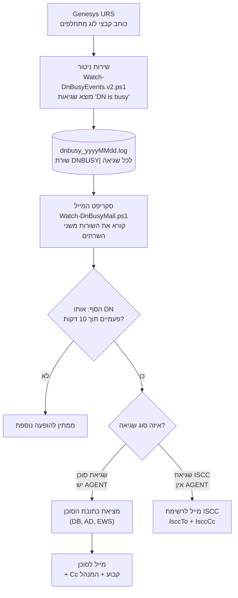

# DN is Busy – ארכיטקטורה (מדריך תפעול)

המערכת מזהה שגיאות "DN is busy" בלוגים של Genesys URS ושולחת מייל לסוכן (או לקבוצת תמיכה במקרה של ISCC).

> המסמך משקף את המצב הנוכחי (כולל שני שרתי ניטור, סף של 2 הופעות, CcManager, חיפוש ב-DB ובקשת ה-EWS). הגרסה האנגלית `ARCHITECTURE.md` לא עודכנה.

## 1. תרשים זרימה



אותו תהליך בטקסט:

```
לוגים של URS
   |
   v
שירות הניטור (מוצא "DN is busy")
   |
   v
dnbusy_yyyyMMdd.log   (שורת DNBUSY| לכל שגיאה)
   |
   v
סקריפט המייל  --- סף: אותו DN פעמיים תוך 10 דקות ---
   |
   +--- שגיאת סוכן (יש AGENT) ---> כתובת הסוכן (DB / AD / EWS) ---> מייל לסוכן (+ Cc + המנהל)
   |
   +--- שגיאת ISCC (אין AGENT) ---> מייל ל-IsccTo (+ IsccCc)
```

## 2. שני רכיבים בלתי תלויים

| שלב | תוכנית | תפקיד |
|---|---|---|
| 1 | `Watch-DnBusyEvents.v2.ps1` | קוראת את לוגי ה-URS וכותבת רשומה אחת לכל אירוע "DN is busy" |
| 2 | `Watch-DnBusyMail.ps1` | קוראת את הרשומות ושולחת מייל (עם סף ומניעת כפילויות) |

החיבור ביניהם הוא רק קובץ הפלט היומי.

## 3. שלב 1 – שירות הניטור

- רץ בנפרד בכל שרת: **Primary** ו-**Backup**, כל אחד כותב לתיקיית פלט משלו.
- קלט: `UniversalRoutingServer_Backup*.log` (התיקייה `D:\Genesys_Logs\UniversalRoutingServer_Backup`).
- פלט: `dnbusy_yyyyMMdd.log` בתיקיית הפלט (נשמר 7 ימים, ישנים נמחקים).
- הקבצים נקראים **לפי שם** (חותמת הזמן בשם), והקובץ הישן נקרא עד סופו לפני המעבר לחדש.
- הטריגר: `AttributeErrorMessage 'DN is busy'` בבלוק `EventError` של ה-T-Server.

### שני סוגי אירועים

| | אירוע סוכן | אירוע ISCC |
|---|---|---|
| איך מזהים | בבלוק יש extension בשם `'AGENT'` | אין `'AGENT'`, יש רק `'iscc-destination-dn'` |
| הערה | גם בבלוקים של סוכן מופיע `iscc-destination-dn`, לכן השדה הזה לבדו **לא** אומר ISCC | העברה ל-DN שהיה תפוס |
| הרשומה | `DNBUSY\|DetectedAt=…\|DN=…\|Place=…\|Agent=…\|VQ=…\|ConnID=…\|LogFile=…` | `DNBUSY\|DetectedAt=…\|Type=ISCC\|DN=<iscc-destination-dn>\|Reason=…\|ConnID=…\|LogFile=…` |

כל הרשומות מתחילות ב-`DNBUSY|`.

## 4. שלב 2 – סקריפט המייל

- קורא את קובץ היום משני השרתים (`-SharePath` עם שתי נתיבים). בהפעלה ראשונה **מדלג על מה שכבר בקובץ**.
- מצב ברירת מחדל בטוח: בלי `-SendToAgents` כל המיילים הולכים רק ל-`-TestTo`.

### הסף ומניעת כפילויות

- **סף:** מייל נשלח רק אחרי שאותו DN הופיע `-MinOccurrences` פעמים (ברירת מחדל 2) בתוך `-WithinMinutes` (ברירת מחדל 10). הספירה בזיכרון בלבד ומתאפסת באתחול.
- **כפילויות:** מייל אחד לכל סוכן ביום, או אחד ל-`-DedupeMinutes` דקות אם הוגדר (אצלנו 60). שגיאות ISCC נספרות לפי ה-DN.

### למי נשלח המייל

| מקרה | אל (To) | עותק (Cc) | הערה |
|---|---|---|---|
| סוכן, כתובת נמצאה | הסוכן | `-Cc` + המנהל (עם `-CcManager`) | גוף המייל לסוכן |
| סוכן, כתובת לא נמצאה | `-TestTo` | – | עם הערה אדומה בתחתית |
| ISCC, `-IsccTo` הוגדר | `-IsccTo` | `-IsccCc` | גוף מייל נפרד |
| ISCC, `-IsccTo` ריק | `-TestTo` | – | עם הערה |
| בלי `-SendToAgents` | `-TestTo` לכולם | – | עם הערת בדיקה |

### איך מוצאים את כתובת הסוכן

1. אם ערך הסוכן מספרי (מספר עובד) ומוגדר `-SqlServer` – ממירים לשם משתמש דרך `GCTI_Confserv.dbo.cfg_person` (שמירה במטמון שעה).
2. חיפוש ב-Active Directory לפי `sAMAccountName`, `employeeID` או `employeeNumber`.
3. אם לא נמצא ובשימוש `-UseEws` – חיפוש שמות של Exchange (`ResolveNames`), כמו Ctrl+K ב-Outlook. נעשה בו שימוש רק בהתאמה אחת בלבד.

### המנהל (`-CcManager`)

אחרי שנמצאה כתובת הסוכן, מחפשים אותו ב-AD (לפי mail, proxyAddresses, UPN או שם משתמש, בדומיין ואז ביער) וקוראים את תכונת `manager`. מוסיפים את כתובת המנהל ל-Cc **בנוסף** לרשימה הקבועה. אם לא נמצא – המייל נשלח בלעדיו. הסיבה מוצגת רק עם `-Verbose`.

### שליחה

`-UseEws` (HTTPS אל `https://mail.example.com/EWS/Exchange.asmx` עם ההרשאה של המשתמש), או `-SmtpServer`, או Outlook (דורש Outlook פתוח, **לא מתאים לשירות**).

### מצב (State)

הקובץ `sent_yyyyMMdd.txt` בתיקיית `-StateFolder` שומר מי כבר קיבל מייל (שם סוכן או `iscc:<DN>` וזמן), כך שאתחול לא שולח שוב.

## 5. פרמטרים של סקריפט המייל

| פרמטר | משמעות |
|---|---|
| `-SharePath` | תיקיות הפלט של שני הניטורים (רשימה) |
| `-From` | השולח (נדרשת הרשאת Send As) |
| `-TestTo` | כתובת בדיקה וגיבוי. חובה, גם כשלא בשימוש רגיל |
| `-SendToAgents` | שליחה אמיתית לסוכנים ול-ISCC |
| `-UseEws` / `-SmtpServer` | שיטת השליחה |
| `-Cc` | עותק קבוע למיילים לסוכן |
| `-CcManager` | להוסיף גם את מנהל הסוכן ל-Cc |
| `-IsccTo`, `-IsccCc` | נמענים של התראות ISCC |
| `-MinOccurrences`, `-WithinMinutes` | הסף (2 הופעות ב-10 דקות) |
| `-DedupeMinutes` | כל כמה דקות מותר לשלוח שוב לאותו סוכן (0 = פעם ביום) |
| `-SqlServer`, `-SqlDatabase` | המרת מספר עובד לשם משתמש |
| `-StateFolder` | היכן נשמר מי כבר קיבל מייל |
| `-Verbose` | מציג סיבות לכשלי חיפוש (סוכן/מנהל) |

## 6. הרשאות וחשבונות

| רכיב | חשבון | צריך |
|---|---|---|
| שירות הניטור | חשבון השירות / ה-LCA | קריאה מתיקיית הלוגים של URS, כתיבה לתיקיית הפלט |
| תיקיית הפלט (שיתוף) | חשבון המייל | קריאה בלבד |
| סקריפט המייל | המשתמש שמריץ | ראו הטבלה למטה |

| צורך | סיבה | מתי |
|---|---|---|
| קריאה מהשיתופים | קריאת `dnbusy_*.log` | תמיד |
| כתיבה ל-`-StateFolder` | מצב מניעת כפילויות | תמיד |
| **Send As** על תיבת `-From` + כתיבה ל-Sent Items | שליחה ושמירת עותק | `-UseEws` |
| גישה ל-HTTPS של EWS | שליחה וחיפוש שמות | `-UseEws` |
| קריאה מ-Active Directory | כתובת הסוכן והמנהל | `-SendToAgents`, `-CcManager` |
| `SELECT` על `GCTI_Confserv.dbo.cfg_person` | המרת מספר עובד לשם משתמש | `-SqlServer` |

## 7. הפעלה

### שירות הניטור

- **NSSM:** `nssm-conf.ps1` (Primary) ו-`nssm-conf-backup.ps1` (Backup). הפעלה מחדש: `Restart-Service DnBusyMonitor-Primary` / `-Backup`.
- **אפליקציית Third Party Server ב-Genesys:** ראו הערכים בסעיף 7.1. מגבלת שדה Command Line Arguments: 256 תווים.
- **להריץ במקום אחד בלבד:** אם עוברים ל-Genesys, יש לעצור ולבטל את שירות ה-NSSM, אחרת נכתבות רשומות כפולות.

#### 7.1 ערכים לאפליקציית Third Party Server

| שדה | ערך |
|---|---|
| Working Directory | `D:\GCTI\DNisBusyMonitor-Backup` (או `-Primary`) |
| Command Line | `C:\Windows\System32\WindowsPowerShell\v1.0\powershell.exe` |
| Command Line Arguments (עד 256 תווים) | `-nop -ep Bypass -File "D:\GCTI\DNisBusyMonitor-Backup\Watch-DnBusyEvents.v2.ps1" -LogFolder "D:\Genesys_Logs\UniversalRoutingServer_Backup" -OutputFolder "D:\Genesys_Logs\DNisBusyMonitor-Backup" -PollIntervalSeconds 2` (217 תווים) |

אם האפליקציה מסתיימת מיד (התראה Application Failure): לבדוק את הנתיב המוחלט של הסקריפט ואת ה-Working Directory, ולתפוס את השגיאה בקובץ באמצעות `cmd.exe /c … > קובץ 2>&1`.

### סקריפט המייל במחשב וירטואלי לא קבוע

- אין שירות Windows (דורש הרשאות מנהל והמחשב מתאפס). מפעילים את `Start-DnBusyMail.cmd` מתוך שיתוף.
- הסקריפט, ה-cmd ותיקיית ה-state נשמרים **בשיתוף קבוע** (`\\FILE-SERVER\Share\DnBusyMail\`).
- אפשר להפעיל אוטומטית בכניסה למערכת דרך מפתח Run ב-`HKCU` – אם פרופיל המשתמש נשמר באתחול.
- קובץ ה-cmd חייב להיות עם סיומות שורה של Windows (CRLF), ובלי רווח אחרי `^`.
- לא מפעילים עותק שני במקביל.

## 8. פתרון תקלות

| תסמין | מה לבדוק |
|---|---|
| אין שורות חדשות ב-`dnbusy_*.log` | השירות רץ? נתיב הלוג ו-`FilePattern` נכונים? |
| רשומות עם DN/Agent/VQ ריקים | סוג אירוע שהניתוח לא מכיר – לשלוח לי את הבלוק הגולמי |
| המייל הגיע רק ל-`-TestTo` | חסר `-SendToAgents`, או כתובת הסוכן לא נמצאה (ההערה האדומה בתחתית המייל) |
| סוכן עם מספר עובד לא נמצא | חסר `-SqlServer`, או שהשרת/ההרשאה ל-`cfg_person` לא תקינים |
| המנהל לא ב-Cc | להוסיף `-Verbose` ולקרוא את ההודעה. ייתכן ש-AD לא נגיש מהמחשב |
| אותו סוכן לא קיבל מייל נוסף | מניעת כפילויות (פעם ביום, או `-DedupeMinutes`). למחוק את שורתו מקובץ ה-state |
| אין מייל אחרי שגיאה ראשונה | הסף: צריך שתי הופעות תוך 10 דקות |
| הסקריפט נסגר מיד | חסר פרמטר, שגיאת הדבקה בקובץ ה-cmd, או סקריפט ישן בשיתוף |

## 9. מגבלות ידועות

- שני הסקריפטים מדלגים על נתונים שנכתבו בזמן שהם כבויים (מתחברים לסוף הקובץ בהפעלה).
- ספירת הסף נמצאת בזיכרון ונמחקת באתחול.
- שגיאות ISCC נספרות ומטופלות לפי ה-DN, לא לפי שיחה.
- Outlook לא מתאים לשירות; משתמשים ב-`-UseEws` או ב-`-SmtpServer`.
- ערכים כמו `PUT-SQL-HOST-HERE` הם מציינים שיש להחליף בערך האמיתי (שם שרת ה-SQL).
- נוסח גוף המייל (לסוכן ול-ISCC) נמצא בתוך הפונקציה `Send-EventMail` בסקריפט המייל.

## 10. קבצים בתיקייה

| קובץ | תפקיד |
|---|---|
| `Watch-DnBusyEvents.v2.ps1` | סקריפט הניטור |
| `Watch-DnBusyMail.ps1` | סקריפט המייל |
| `Start-DnBusyMail.cmd` | מפעיל את סקריפט המייל מתוך שיתוף |
| `nssm-conf.ps1`, `nssm-conf-backup.ps1` | התקנת שירותי הניטור (Primary / Backup) |
| `nssm-mail-conf.ps1` | התקנת שירות מייל (לא בשימוש ב-VM לא קבוע) |
| `ARCHITECTURE.md`, `ARCHITECTURE-flow.md` | הגרסה האנגלית (לא עודכנה) |
| `Watch-DnBusyEvents.ps1`, `Send-TestMail*.ps1`, `Test-DnBusyMail.ps1` | גרסה ישנה וכלי בדיקה (לא נסקרו) |
