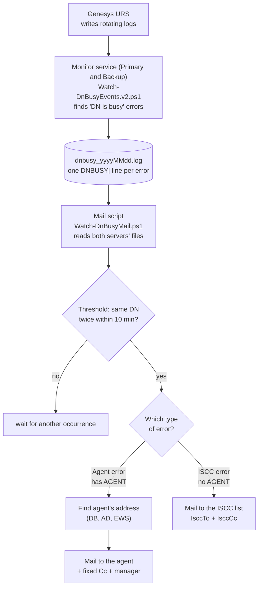

# DN is Busy – Architecture (Ops guide)

Detects Genesys URS "DN is busy" errors in the URS log files and mails the affected agent (or a support group for ISCC events).

> This document reflects the current setup: two monitor servers, the 2-occurrence threshold, `-CcManager`, the DB / AD / EWS address lookup and the non-persistent VM launcher. The Hebrew version is `ARCHITECTURE.he.md`.

## 1. Flow



Same flow as text:

```
URS logs
   |
   v
Monitor service (finds "DN is busy")   [one per server: Primary, Backup]
   |
   v
dnbusy_yyyyMMdd.log   (one DNBUSY| line per error)
   |
   v
Mail script  --- threshold: same DN twice within 10 minutes ---
   |
   +--- Agent error (has AGENT) ---> address (DB / AD / EWS) ---> mail to AGENT (+ Cc + manager)
   |
   +--- ISCC error (no AGENT)   ---> mail to IsccTo (+ IsccCc)
```

## 2. Two independent programs

| Step | Program | Does |
|---|---|---|
| 1 | `Watch-DnBusyEvents.v2.ps1` | Reads URS logs, writes one record per "DN is busy" event |
| 2 | `Watch-DnBusyMail.ps1` | Reads those records, sends one mail per event (with threshold and dedupe) |

They are connected only by the daily output file.

## 3. Step 1 – Log monitor

- Runs separately on each server: **Primary** and **Backup**, each writing to its own output folder.
- Input: `UniversalRoutingServer_Backup*.log` in `D:\Genesys_Logs\UniversalRoutingServer_Backup`.
- Output: `dnbusy_yyyyMMdd.log` in the output folder (7 days kept, older deleted).
- Files are read in **name order** (timestamp in the name); the old file is read to its end before moving to the next, so rotation does not lose or replay lines.
- Trigger: `AttributeErrorMessage 'DN is busy'` in a T-Server `EventError` block.

### Two kinds of event

| | Agent event | ISCC event |
|---|---|---|
| How to tell | Block has an `'AGENT'` extension | No `'AGENT'`, only `'iscc-destination-dn'` |
| Note | Agent blocks **also** contain `iscc-destination-dn`, so that field alone does **not** mean ISCC | Transfer to a DN that was busy |
| Record | `DNBUSY\|DetectedAt=…\|DN=…\|Place=…\|Agent=…\|VQ=…\|ConnID=…\|LogFile=…` | `DNBUSY\|DetectedAt=…\|Type=ISCC\|DN=<iscc-destination-dn>\|Reason=…\|ConnID=…\|LogFile=…` |

Every record starts with `DNBUSY|`.

## 4. Step 2 – Mail script

- Reads today's file from both servers (`-SharePath` takes a list). On first start it **skips what is already in the files**.
- Safe default: without `-SendToAgents`, all mail goes to `-TestTo` only.

### Threshold and dedupe

- **Threshold:** a mail is sent only after the same DN was seen `-MinOccurrences` times (default 2) within `-WithinMinutes` (default 10). The count is held in memory and is lost on restart.
- **Dedupe:** one mail per agent per day, or one per `-DedupeMinutes` if set (we use 60). ISCC events are deduped per DN.

### Who gets the mail

| Case | To | Cc | Note |
|---|---|---|---|
| Agent, address found | the agent | `-Cc` + the manager (with `-CcManager`) | agent mail body |
| Agent, address not found | `-TestTo` | – | red note at the bottom |
| ISCC, `-IsccTo` set | `-IsccTo` | `-IsccCc` | separate ISCC body |
| ISCC, `-IsccTo` empty | `-TestTo` | – | with a note |
| Without `-SendToAgents` | `-TestTo` for everything | – | test note |

### Finding the agent's address

1. If the agent value is numeric (employee id) and `-SqlServer` is set, it is mapped to a user name through `GCTI_Confserv.dbo.cfg_person` (cached for an hour).
2. Active Directory is searched by `sAMAccountName`, `employeeID` or `employeeNumber`; the `mail` attribute is used.
3. If AD finds nothing and `-UseEws` is on, Exchange name resolution (`ResolveNames`, the same as Ctrl+K in Outlook) is tried. A result is used only when it is a single match.

### The manager (`-CcManager`)

Once the agent's address is known, AD is searched for the agent (by mail, proxyAddresses, UPN or user name; local domain, then the forest) and its `manager` attribute is read. The manager's address is added to the Cc **in addition** to the fixed `-Cc` list. If no manager is found, the mail is sent without one; the reason is shown only with `-Verbose`.

### Sending

`-UseEws` (HTTPS to `https://mail.example.com/EWS/Exchange.asmx` with the user's Windows login), `-SmtpServer`, or Outlook (needs Outlook open; **not usable as a service**).

### State

`sent_yyyyMMdd.txt` in `-StateFolder` records who was already mailed (agent name or `iscc:<DN>`, and time), so a restart does not re-send.

## 5. Mail script parameters

| Parameter | Meaning |
|---|---|
| `-SharePath` | output folders of both monitors (a list) |
| `-From` | sender (needs Send As) |
| `-TestTo` | test and fallback address. Mandatory, even when not used normally |
| `-SendToAgents` | real sending to agents and the ISCC list |
| `-UseEws` / `-SmtpServer` | how mail is sent |
| `-Cc` | fixed CC on agent mails |
| `-CcManager` | also CC the agent's manager |
| `-IsccTo`, `-IsccCc` | recipients of ISCC alerts |
| `-MinOccurrences`, `-WithinMinutes` | the threshold (2 within 10 minutes) |
| `-DedupeMinutes` | how often the same agent may be mailed again (0 = once a day) |
| `-SqlServer`, `-SqlDatabase` | maps employee id to user name |
| `-StateFolder` | where "already mailed" is remembered |
| `-Verbose` | shows why an agent or manager lookup failed |

## 6. Permissions and accounts

| Component | Account | Needs |
|---|---|---|
| Monitor service | its service / LCA account | Read on the URS log folder; write on its output folder |
| Output folder (share) | the mail account | Read only |
| Mail script | the user who runs it | see below |

| Need | Why | Needed when |
|---|---|---|
| Read on the shares | reads `dnbusy_*.log` | always |
| Write on `-StateFolder` | dedupe state | always |
| **Send As** on the `-From` mailbox + write to its Sent Items | sending and saving a copy | `-UseEws` |
| HTTPS to the EWS URL | sending and name resolution | `-UseEws` |
| Read from Active Directory | agent and manager addresses | `-SendToAgents`, `-CcManager` |
| `SELECT` on `GCTI_Confserv.dbo.cfg_person` | employee id to user name | `-SqlServer` |

## 7. Run and restart

### Monitor service

- **NSSM:** `nssm-conf.ps1` (Primary) and `nssm-conf-backup.ps1` (Backup). Restart with `Restart-Service DnBusyMonitor-Primary` / `-Backup`.
- **Genesys Third Party Server application:** see 7.1. The Command Line Arguments field is limited to 256 characters.
- **Run it in one place only:** if you move to Genesys, stop and disable the NSSM service, or duplicate records are written.

#### 7.1 Third Party Server values

| Field | Value |
|---|---|
| Working Directory | `D:\GCTI\DNisBusyMonitor-Backup` (or `-Primary`) |
| Command Line | `C:\Windows\System32\WindowsPowerShell\v1.0\powershell.exe` |
| Command Line Arguments (max 256) | `-nop -ep Bypass -File "D:\GCTI\DNisBusyMonitor-Backup\Watch-DnBusyEvents.v2.ps1" -LogFolder "D:\Genesys_Logs\UniversalRoutingServer_Backup" -OutputFolder "D:\Genesys_Logs\DNisBusyMonitor-Backup" -PollIntervalSeconds 2` (217 characters) |

If the application terminates right away (Application Failure alarm): check the absolute script path and the Working Directory, and capture the error to a file with `cmd.exe /c … > file 2>&1`.

### Mail script on a non-persistent VM

- No Windows service (needs admin rights and the VM resets). Run `Start-DnBusyMail.cmd` from a share.
- Keep the script, the cmd and the state folder on a **persistent share** (`\\FILE-SERVER\Share\DnBusyMail\`).
- It can start automatically at logon through a Run key in `HKCU`, if the user profile survives restarts.
- The cmd file must have Windows (CRLF) line endings and no space after `^`.
- Do not run a second copy at the same time.

## 8. Troubleshooting

| Symptom | Check |
|---|---|
| No new lines in `dnbusy_*.log` | Monitor running? Log folder path and `FilePattern` correct? |
| Records with empty DN/Agent/VQ | An event type the parser does not know; send the raw block |
| Mail only goes to `-TestTo` | `-SendToAgents` missing, or the agent's address was not found (red note at the bottom of the mail) |
| Agent with a numeric id not resolved | `-SqlServer` missing, or the server / `cfg_person` permission is wrong |
| Manager not in Cc | Add `-Verbose` and read the message; AD may not be reachable from the VM |
| Same agent not mailed again | Dedupe (once a day, or `-DedupeMinutes`); remove the agent's line from the state file |
| No mail after the first error | Threshold: two occurrences within 10 minutes are needed |
| Script window closes at once | Missing parameter, a typo in the cmd, or an old script on the share |

## 9. Known limitations

- Both programs skip data written while they are stopped (they attach to the end of the file at start).
- The threshold count is in memory and is lost on restart.
- ISCC events are counted and deduped per DN, not per call.
- Outlook mode cannot run as a service; use `-UseEws` or `-SmtpServer`.
- Values such as `PUT-SQL-HOST-HERE` are placeholders; replace them with the real SQL server name.
- The mail wording (agent and ISCC) is inside `Send-EventMail` in the mail script.

## 10. Files in the folder

| File | Purpose |
|---|---|
| `Watch-DnBusyEvents.v2.ps1` | the monitor script |
| `Watch-DnBusyMail.ps1` | the mail script |
| `Start-DnBusyMail.cmd` | starts the mail script from a share |
| `nssm-conf.ps1`, `nssm-conf-backup.ps1` | installs the monitor services (Primary / Backup) |
| `nssm-mail-conf.ps1` | installs a mail service (not used on the non-persistent VM) |
| `ARCHITECTURE.he.md`, `ARCHITECTURE-flow.md` | Hebrew version; simple flow |
| `Watch-DnBusyEvents.ps1`, `Send-TestMail*.ps1`, `Test-DnBusyMail.ps1` | old version and test helpers (not reviewed) |
